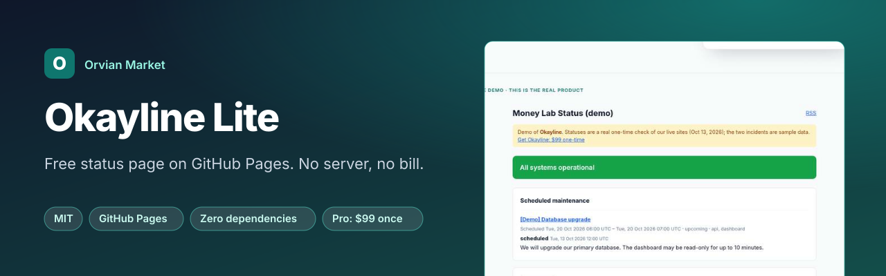

<b><a href="https://orvianmarketplace.com/okayline-demo/">Live demo</a></b> · <a href="#quick-start">Quick start</a> · <a href="#lite-vs-pro">Lite vs Pro</a> · ⭐ <b>Star this repo</b> if it saves you a subscription

# Okayline Lite: a free status page on GitHub Pages

> **Need more than Lite?** [Okayline Pro](https://jhodges6.gumroad.com/l/bcmhvk) adds the full feature set below for **$99 once**. No subscription, 14-day refund. [See the live demo →](https://orvianmarketplace.com/okayline-demo/)

A free, open-source status page you host yourself. Edit one JSON file, push, and GitHub Pages publishes it. No server, no monthly bill, no dependencies.

**Live demo of the full version:** https://orvianmarketplace.com/okayline-demo/

## Quick start (5 minutes)
1. Click **Use this template** (or fork).
2. Go to **Settings → Pages → Source: GitHub Actions**.
3. Edit `status.json`. Each component's status can be `operational`, `degraded`, `outage` or `maintenance`. Add an optional `notice`.
4. Commit. Your page goes live at `https://YOU.github.io/REPO/`.

Build locally: `node build.mjs` (Node 18+).

## See it in action

## Lite vs Pro
| | Lite (free, MIT) | [Okayline Pro ($99 one-time)](https://jhodges6.gumroad.com/l/bcmhvk) |
|---|---|---|
| Static status page with manual statuses | ✅ | ✅ |
| Automatic uptime checks every ~5 min | – | ✅ |
| 90-day uptime history bars | – | ✅ |
| Incident timeline written in Markdown, plus scheduled maintenance | – | ✅ |
| RSS feed for subscribers | – | ✅ |
| Admin helper page and custom-domain guide | – | ✅ |
| Email support and updates | – | ✅ |

## About
Built from scratch by Orvian Market. An independent alternative to hosted status-page services; not affiliated with Atlassian Statuspage or any other vendor. All trademarks belong to their owners.

License: MIT (Lite only). Okayline Pro is sold separately under its own license.
